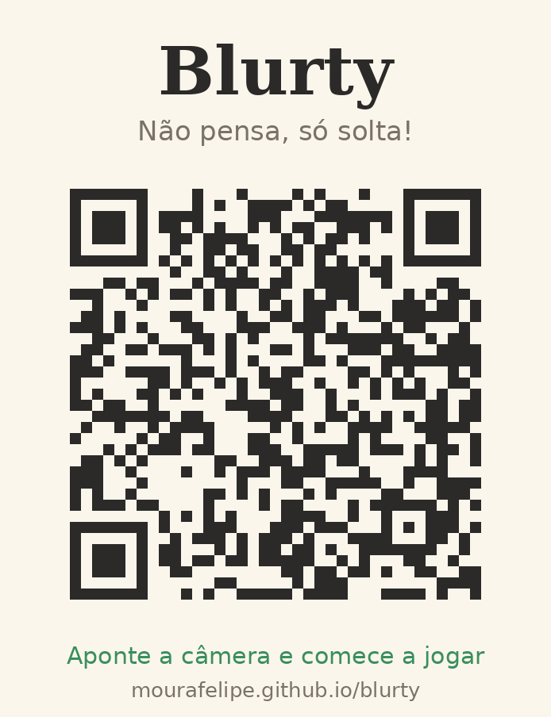
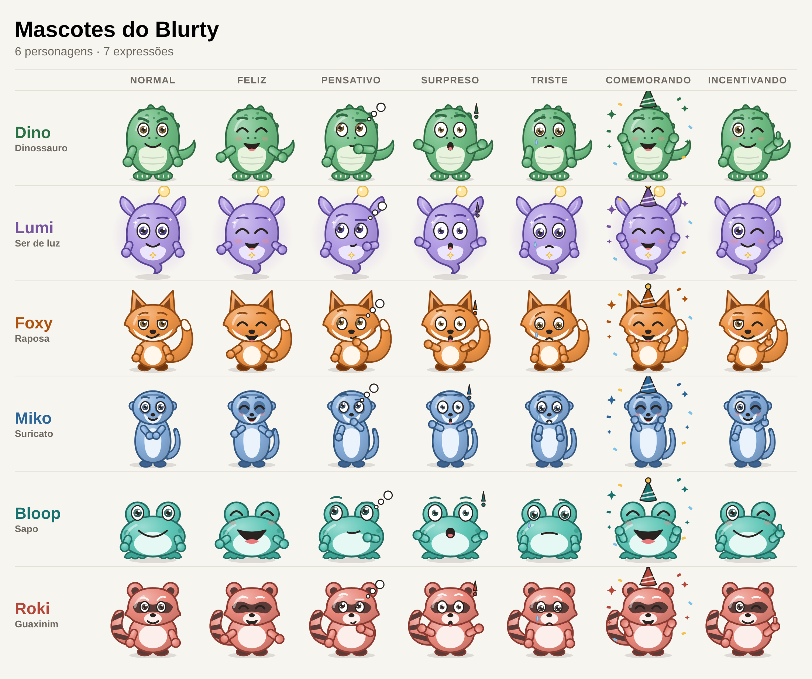

# Blurty

**Blurt it out!** Aprenda inglês de conversa jogando, sem medo de errar: fases curtas, cada uma com um objetivo, e um mascote que acompanha você.

*To blurt* é soltar as palavras sem pensar demais. No Blurty você se joga, fala sem medo e erra sem medo: errar faz parte de aprender.

👉 **Jogar:** https://mourafelipe.github.io/blurty/

## App no celular
No site, o Blurty pode ser instalado na tela inicial e abre como app, até sem internet (`manifest.webmanifest`, `sw.js` e ícones `icon-*.png`). No Perfil, o card "Blurty no celular" mostra o botão ou o passo a passo para instalar.

## Mascotes

## Como funciona
- **Mascote:** no primeiro acesso você escolhe um companheiro (Dino, Lumi, Foxy, Miko, Bloop ou Roki), cada um com desenho e personalidade próprios. Ele define as cores do app, reage às suas respostas e te incentiva a cada 5 exercícios. Dá para trocar no Perfil sem perder nada.
- **Blocos e fases:** cada bloco tem 5 fases; cada fase tem um objetivo, um cartão "Aprenda" e 3 exercícios.
- **Exercícios:** tradução, completar frase, responder numa conversa, montar frase, situação, encontrar o erro, interpretar diálogo, associar e construir resposta.
- **Desafios surpresa:** no caminho do mapa aparece um 🎁 depois das fases 2 e 4 de cada bloco. Ele é opcional e só mostra o conteúdo ao abrir: uma expressão secreta e 4 exercícios (3 sorteados das fases anteriores e 1 da expressão). Acertando 3 de 4, você ganha um item para o mascote (óculos escuros, coroa, boné ou flor) e +50 XP. Os itens ficam no Perfil, em "Personalize o seu mascote". Não vencer também vale: a expressão secreta já foi aprendida e a tentativa dá XP.
- **Progresso:** XP, sequência de dias, taxa de acertos, histórico, conquistas e revisão do que você errou. Fica salvo no navegador.

## Conteúdo atual
- Bloco 1 — First Conversations (iniciante): 5 fases, 15 exercícios.
- Bloco 2 — Daily Life (básico): 5 fases, 15 exercícios. Abre quando o Bloco 1 é concluído.
- Blocos 3 a 5 aparecem como "em breve".

## Editar
- Conteúdo: `src/block1.js` e `src/block2.js` (novos blocos seguem o mesmo formato e entram em `MAIN`, em `src/app.html`, e em `src/build.py`)
- Desafios surpresa e prêmios: `src/challenges.js`
- Mascotes, cores e mensagens: `src/mascots.js`
- Desenho dos mascotes, expressões e acessórios: `src/mascot-art.js`
- App: `src/app.html`
- Gerar o `index.html`: `python3 src/build.py`
